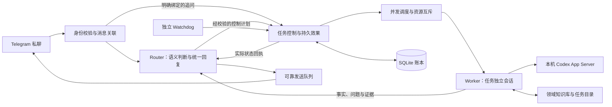

# Codex Super Agent

通过一个 Telegram 私聊，协调 Windows 本机的多个 Codex 任务。Router 负责语义分流和统一回复，Worker 执行任务；任务、消息关联和恢复状态保存在本机。

这是基于官方 Codex App Server 的自定义客户端，不是 OpenAI 官方 Telegram 产品。当前适配基于 Codex 0.166.0；协议包含实验能力，升级 Codex 后应重新验收。

## 工作方式



- **职责与会话**：Worker 的职责长期保留，同职责可以有多个任务。每个任务有独立原生 Codex 会话；明确回复关系可跳过模型分流，结果仍交给 Router 组织。
- **上下文开销**：Router 先读短任务卡片，需要时按引用分页查询，不读取全部 Worker 对话。其原生会话按预算轮换；任务、待确认问题和近期实际发送的回复可重新加载。
- **任务控制**：暂停调度与单项停止分开记录。人工停止不自动恢复。取消指代必须关联明确回复、具体任务名或结构化确认；已完成任务保留完成状态。
- **统一表达**：Router 每轮加载安装目录 `superagent-state/AGENTS.md`。Worker 只交内部结果和证据。取消回执必须包含实际受影响的任务名称。
- **可配置模型**：Router、Worker、Watchdog 分开配置，职责可覆盖 Worker 模型；Telegram 菜单支持模型和思考强度。可用值由本机模型目录验证。
- **权限**：使用 Codex 原生审批；`auto_review` 是自动风险审核，不表示无限权限或保证批准。
- **可靠执行**：SQLite 事务记录事件及待执行效果；原生请求关联、代次和状态核对用于防止重连时盲目重复执行。Telegram 自身无发送幂等键，通知仍可能重复。
- **调度与恢复**：并发独立任务、共享文件/桌面资源排队；独立 Watchdog 检查心跳，必要时核对原生状态并有限重试，不擅自扩大权限。
- **知识沉淀**：领域知识按适用条件和证据保存、按需检索；任务会话不互相灌入完整上下文。主动尝试受时间、重试和资源上限约束，额外改进留在隔离副本。
- **媒体**：沿用现有 Telegram/Telegraf、Whisper、FFmpeg 支持图片、语音和文件。传输文件不等于自动理解所有格式；PDF 等产物生成取决于本机已安装的工具。

## 代码位置

| 模块 | 代码 |
| --- | --- |
| 语义 Router、上下文预算与回复 | `superagent/router.mjs` |
| 消息订阅、确认、派发及控制 | `superagent/routing.mjs`、`core.mjs` |
| 账本、持久效果与运行循环 | `store.mjs`、`runtime.mjs`、`system.mjs` |
| 原生会话和 Worker 执行 | `native.mjs`、`executor.mjs` |
| 并发、资源锁 | `scheduler.mjs` |
| 审核、模型菜单与配置 | `approvals.mjs`、`controls.mjs`、`settings.mjs` |
| 知识、文件与主动观察 | `knowledge.mjs`、`files.mjs`、`supervision.mjs` |
| 统一发送与消息关联 | `delivery.mjs` |
| Watchdog 与本机控制端口 | `watchdog.mjs`、`watchdog-host.mjs`、`control.mjs` |
| Telegram 适配器及媒体复用 | `telegram-bridge/` |
| 版本化部署 | `scripts/deploy.ps1` |

## 本地验证

环境：Windows、Node.js 24+、已登录且支持所需 App Server 协议的 Codex。语音功能另需 Whisper/FFmpeg。本仓库不携带任何用户认证、Bot Token、聊天记录或原生会话。

```powershell
npm ci --prefix telegram-bridge --ignore-scripts
npm test
```

完整测试包含 Windows 凭据加解密测试，需要在正常 Windows 用户环境运行。隔离的真实模型回归测试会创建测试会话并使用账户额度，但不发送 Telegram 消息、不启动 Worker、不修改生产任务：

```powershell
node superagent/probe-cancel.mjs C:\path\to\existing-bot\config.json C:\path\to\local-result.json
```

## 运行与部署

当前部署脚本用于**升级已经完成身份绑定的现有本机安装**，不是面向陌生电脑的一键安装器。它需要已有 `config.json`、运行账本、启动脚本及两个 Windows 计划任务。它会检查空闲状态，备份并建立独立版本目录，记录源码提交和文件哈希后切换入口。运行配置及个人偏好文件继续放在安装目录中。

```powershell
# 在具有计划任务管理权限的 PowerShell 中，对干净且已提交的源码执行：
.\scripts\deploy.ps1 -Runtime C:\path\to\existing-bot
```

不要把生产配置复制进本仓库。完整日常操作、目录、恢复和权限边界见 [OPERATIONS.md](superagent/OPERATIONS.md)。电脑必须开机、登录且在线；本项目不提供关机期间的云端接单服务。

## 可追溯约定

每次迭代提交代码、相关回归测试及 [CHANGELOG.md](CHANGELOG.md)。部署只接受干净的 Git 提交；安装目录的 `superagent-release.json` 记录 `sourceCommit`、上一版、备份和入口，版本目录 `manifest.json` 记录逐文件 SHA-256。回滚源码不等于回滚任务账本，不恢复旧 Telegram 消息游标。

第一个提交是此前运行版本的源码快照；不会伪造更早的 Git 开发历史。原型思想与复用来源见 [SOURCE-NOTES.md](superagent/SOURCE-NOTES.md)，第三方许可保留在 `telegram-bridge/vendor/`。
